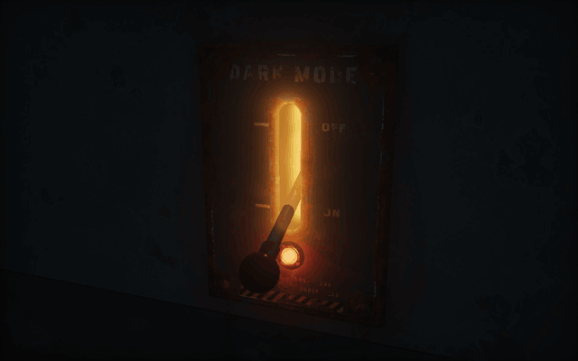
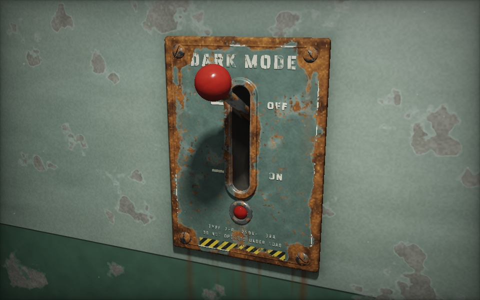
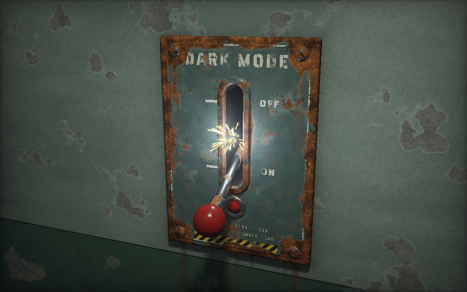
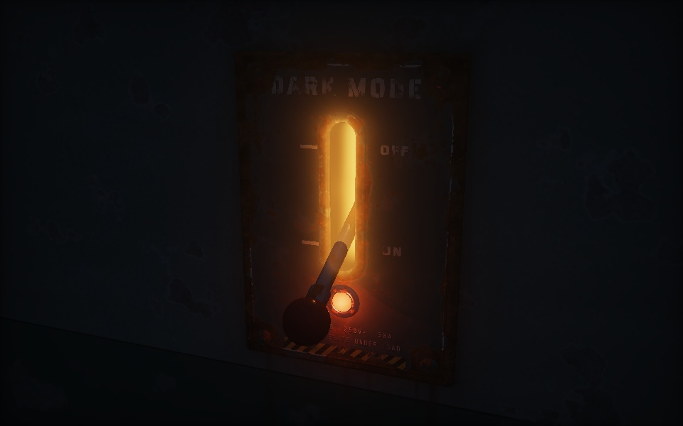

# Rusty Switch

**A dark-mode toggle that's an old rusted lever switch: it sticks, grinds, sparks, and kills the lights.**

<p align="center">
  <a href="https://matthew-eucaristo.github.io/rusty-switch/">
    
  </a>
</p>

<p align="center">
  <a href="https://matthew-eucaristo.github.io/rusty-switch/"><b>▶ Try the live demo</b></a> (turn your sound on)
  &nbsp;·&nbsp;
  <a href="media/demo.mp4">Sharper video (MP4, no sound)</a>
</p>

---

## What this is

A dark-mode switch made as the clunky opposite of a polished, smooth one. It started from a
[ferrofluid dark-mode toggle](https://x.com/argofowl/status/2119867622108066283), a single HTML file
with no libraries and sounds generated in the browser. This version keeps those rules but swaps the
glossy liquid for a corroded industrial lever bolted to a peeling hospital-green wall.

- **Lever up (OFF):** the fluorescent tubes are on. That's light mode.
- **Lever down (ON):** the tubes die, a red pilot lamp warms up, and the slot glows orange from inside the box. That's dark mode.

| Light mode | The throw | Dark mode |
|:---:|:---:|:---:|
|  |  |  |

## How it behaves

- **The first hit always jams.** The lever strains and shakes, then the page says *"RUSTED SOLID — HIT IT AGAIN."* After the switch has sat idle for a while, it can jam again.
- **Drag it** and you feel the stiction: it holds, breaks loose, catches on rust notches, then gets away from you and slams over past centre.
- **The snap** gives you a metal clunk with screws rattling afterwards, camera shake, rust dust and tumbling flakes, and sparks where the contacts meet.
- **Lights out:** the tubes sputter and die. The pilot lamp fades in, then the slot ignites with an orange ember glow and a transformer buzz.
- **Lights on:** the tubes struggle to start with the classic *tick… tick… flicker… ping* before they catch.
- **Leave it half-thrown** and it sticks in the middle, arcing, crackling and making the lights stutter.
- Starts in your system's light/dark preference. There's a sound toggle in the top-right corner.

**Controls:** drag the lever up/down, or click/tap anywhere to hit it. When the switch has focus, **Space** and **Enter** work too.

## How it's built

All of it is one file, [`index.html`](index.html), with no libraries, no assets, and no build step.

| Part | How it works |
|---|---|
| **Rendering** | A full-screen WebGL2 fragment shader that raymarches signed distance fields: wall, faceplate, slot bezel, cavity, screws, jewel lamp, and the lever. |
| **Materials** | Procedural noise for paint, rust, pitting, blisters, rust drips, peeling wall paint and chipped bakelite. Uses GGX lighting, soft shadows and ambient occlusion. |
| **Lettering** | The stamped *DARK MODE*, OFF/ON, rating plate and hazard stripes are drawn to a 2D canvas, then used as a texture for raised lettering and paint masks. |
| **Lights** | A ceiling fluorescent with soft shadows, plus a dim blue night fill, an orange point light inside the slot, the red pilot lamp, and a blue-white flash when it sparks. Glow halos are added in screen space. |
| **Physics** | An over-centre spring toggle with static and kinetic friction (stick-slip), position-dependent rust notches, bounce off the end stops, and a "hand" spring that follows your drag. |
| **Sound** | All synthesized with the Web Audio API: impact thump with metal modes and saturation, stick-slip creak grains, an electric arc crackle, 120 Hz tube hum, starter ticks, the strike *ping*, ember buzz and pops. It all goes through a generated room reverb. |
| **Particles** | Sparks, dust and flakes are simulated in 3D, then projected onto a 2D canvas overlay. |
| **Performance** | Render resolution adapts to frame time. Honors `prefers-reduced-motion` (no shake, fewer particles). |

## Run it locally

Open `index.html` in a browser that supports WebGL2. To serve it locally instead, run this and then go to http://localhost:8000:

```bash
python3 -m http.server 8000
```

## Files

```
index.html        the whole thing
media/demo.gif    the README demo
media/demo.mp4    sharper 10-second capture
media/*.jpg       stills
```

---

Made in November 2026. This repo is archived as a keepsake.
